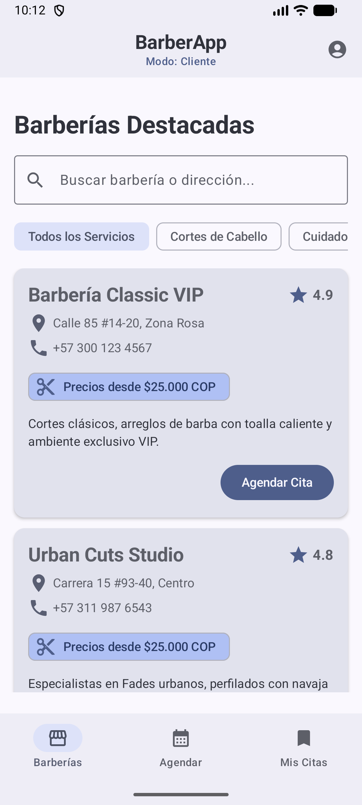
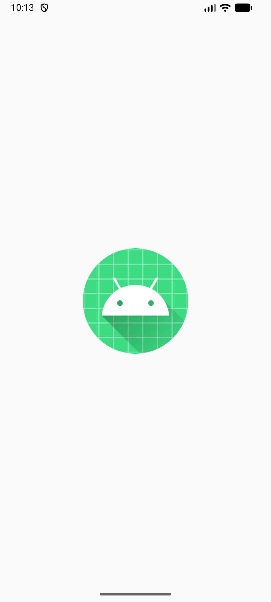

# android-actividad-4

**ACTIVIDAD 4 - CONSTRUCCIÓN DE LOGIN EN JETPACK COMPOSE**  
*Aplicaciones Móviles Android · Profe Jhon Fredy Valencia · SmartClass*

---

## 📱 Descripción del Proyecto

Proyecto de aplicación móvil Android nativa desarrollada utilizando **Jetpack Compose** y **Material Design 3**. Incluye la implementación paso a paso de un flujo de autenticación compuesto por la pantalla principal de inicio de sesión (`LoginScreen`), pantalla de registro (`RegistroScreen`) y pantalla de recuperación de contraseña (`RecuperarScreen`).

---

## 🚀 Contenido y Pantallas

### Parte 1 - Login Hecho a Mano (`LoginScreen.kt`)
* **Ubicación:** `app/src/main/java/com/example/composable/ui/screen/LoginScreen.kt`
* **Características:**
  * Logotipo centrado con icono de usuario (`AccountCircle`) en color `Primary`.
  * Encabezados de bienvenida (*"¡Bienvenido de nuevo!"* e *"Inicia sesión para continuar"*).
  * Manejo de estados con `remember` y `mutableStateOf` para correo y contraseña.
  * Campo de correo electrónico (`OutlinedTextField`) con icono `Email`.
  * Campo de contraseña con icono `Lock` y botón interactivo (ojo) para alternar visibilidad mediante `PasswordVisualTransformation`.
  * Botón *"¿Olvidaste tu contraseña?"* alineado a la derecha.
  * Botón principal *"Iniciar Sesión"*.
  * Divisor horizontal *"O continúa con"*.
  * Botón *"Continuar con Google"* con icono `AccountBox` en color Google (`#EA4335`).
  * Enlace inferior *"¿No tienes una cuenta? Regístrate"*.

### Parte 2 - Pantallas de Registro y Recuperación
* **`RegistroScreen.kt`**:
  * **Ubicación:** `app/src/main/java/com/example/composable/ui/screen/RegistroScreen.kt`
  * Botón de navegación hacia atrás.
  * Título *"Crea tu cuenta"* y subtítulo *"Empieza tu viaje con nosotros"*.
  * Campos de texto: *Nombre completo*, *Correo electrónico*, *Contraseña* y *Confirmar contraseña*.
  * Checkbox de *"Acepto los términos y condiciones"*.
  * Botón principal *"Crear cuenta"* con estilo Material 3 índigo.
  * Botón *"Continuar con Google"* y pie de página *"¿Ya tienes una cuenta? Inicia sesión"*.

* **`RecuperarScreen.kt`**:
  * **Ubicación:** `app/src/main/java/com/example/composable/ui/screen/RecuperarScreen.kt`
  * Círculo central en tono índigo claro con icono de candado.
  * Título *"¿Olvidaste tu contraseña?"* y párrafo instructivo.
  * Campo para ingreso del correo electrónico asociado.
  * Botón principal *"Enviar enlace de recuperación"* con icono de avión de papel (`Send`).
  * Botón de texto *"Volver a iniciar sesión"*.
  * Tarjeta informativa al final para revisión de carpeta de spam.

---

## 📸 Capturas de Pantalla

| Inicio de Sesión (`LoginScreen`) | Crear Cuenta (`RegistroScreen`) | Recuperar Contraseña (`RecuperarScreen`) |
| :---: | :---: | :---: |
|  |  |  |

---

## 📂 Estructura del Proyecto

```text
android-actividad-4/
├── app/
│   └── src/main/java/
│       ├── com/example/composable/
│       │   └── ui/
│       │       ├── screen/
│       │       │   ├── LoginScreen.kt
│       │       │   ├── RegistroScreen.kt
│       │       │   └── RecuperarScreen.kt
│       │       └── theme/
│       │           └── Theme.kt
│       └── com/example/login/
│           ├── MainActivity.kt
│           └── ui/theme/
├── screenshots/
│   ├── login_emulator.png
│   ├── registro_emulator.png
│   └── recuperar_emulator.png
├── build.gradle.kts
└── README.md
```

---

## 🛠️ Requisitos e Instalación

1. **Android Studio:** Ladybug / Iguana o superior (compatibilidad con Jetpack Compose y Kotlin 2.0+).
2. **Clonar el repositorio:**
   ```bash
   git clone https://github.com/andresquintoquintobejarano-art/Andrroid-Actvidad-4.git
   ```
3. Abrir el proyecto en Android Studio, sincronizar Gradle (`Sync Project with Gradle Files`) y ejecutar en un emulador Android (API 24+).
